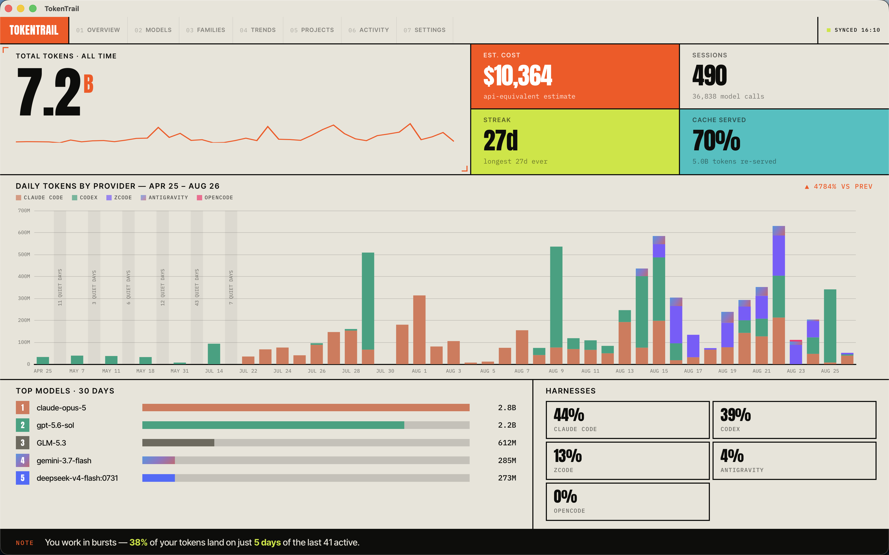

<h1 align="center">TokenTrail</h1>

**WackCode integration:** TokenTrail automatically imports WackCode's small local usage ledger,
without reading its conversations. New usage is recorded by default in WackCode's
Settings > Integrations, retained indefinitely, and imported every 30 seconds. The overview's
**WackCode Usage** table breaks down chat, sub-agents, titles, compaction, branch summaries,
goal verification, and commit messages. Costs are API-equivalent estimates, not subscription
spend. Missing provider counts are not estimated. Historical chats from before recording
was enabled are not imported. See the [usage contract](docs/wackcode-usage-v1.md) for the
local path, metadata, privacy boundaries, and coverage limits.

<p align="center">
  One dashboard for all the AI tokens you burn while coding.
</p>

<p align="center">
  
  
  
</p>

---

TokenTrail is a desktop app that reads the usage logs your AI coding tools already write on your machine and turns them into a single, clear picture — tokens, cost estimates, sessions, projects, and daily trends. No accounts, no setup: open it and your history is there.



## Supported tools

| Harness | Notes |
| --- | --- |
| ZCode | Local session logs + subagents |
| Claude Code | Includes subagent sessions |
| Codex | Sessions + subagent threads |
| OpenCode | Per-project usage |
| Gemini CLI | Session history |
| Antigravity | Conversation databases |
| WackChatter | Dedicated offline Stats, character portraits, groups, and retained generation usage |

If a tool isn't installed, it's simply skipped — TokenTrail shows whatever it finds.

WackChatter is the odd one out: not a coding tool, and the only source that can report a
token count it worked out itself rather than one a provider billed. Those are marked
**estimated** in Settings and never contribute a cost figure.

## What you get

- **Overview** — totals, sessions, active-day streak, cache hit rate, and spend estimate at a glance
- **Models & Families** — usage and cost broken down per model or model family
- **Trends** — how your usage moves day to day
- **Projects** — which projects consume the most tokens
- **Activity** — a live feed of recent sessions as they sync in
- **Settings** — merge duplicate model names, hide noise, export your data

## Private by design

- Everything runs **locally** — no accounts, no telemetry, no cloud.
- Your harness files and databases are opened **read-only**. TokenTrail never writes to them.
- Your history lives in TokenTrail's own local database and can be exported anytime.

> **A note on cost:** figures are API-equivalent estimates based on bundled list prices — not what you actually pay on a subscription.

## Getting started

Download the latest build for your platform from the [Releases](../../releases) page, launch it, and that's it. TokenTrail syncs in the background and refreshes automatically.

### Building from source

You'll need [Bun](https://bun.sh) and [Rust](https://rustup.rs).

```bash
bun install
bun run tauri dev    # run in dev mode
bun run tauri build  # produce a production build
```

## Tech stack

Tauri 2 (Rust backend) · SvelteKit + Svelte 5 frontend · ECharts · SQLite

## License

[MIT](LICENSE) — do whatever you want with it.

## WackChatter Stats

Open **WackChatter** in TokenTrail for all-time library statistics: characters, groups,
conversations, personas, models, activity, and habits. **Usage** adds date-filtered,
retained generation accounting across chat, Arena, memory, and creation features.
Measured and estimated tokens remain separate; costs are API-equivalent estimates,
not actual subscription spend. Library changes update Stats without deleting usage.

WackChatter's **Stats in TokenTrail** action opens the matching library. Stats and
portraits work with WackChatter closed; opening a chat requires the matching library
running locally. TokenTrail reads external data read-only and never copies transcripts.
See the [integration contract](docs/wackchatter-integration.md).

For browser UI previews, open `/wackchatter?mock`. Integration regression tests run with
`bun test tests`; Rust tests include golden fixtures captured from WackChatter's former
Stats suite. Test packaged `tokentrail:` links on each target OS before release.
